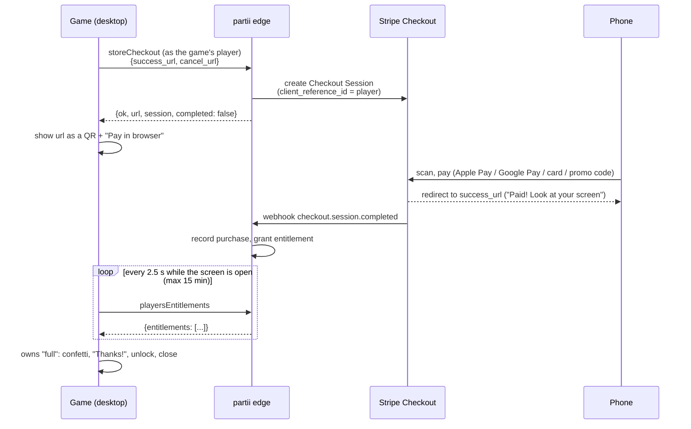

# Buy Flow: "Get the Full Game"

How Bouncy Blobs sells the full game from inside the game, on every
platform, and how to give the next partii game the same flow. The demo
model itself (join free, host only if owned, the first chapters free) is
`crates/bb-game/src/ownership.rs` and the partii GUIDE §4.

## Platforms

| Platform | What "Get the Full Game" does | Code |
| --- | --- | --- |
| **iOS / iPadOS** | StoreKit 2 sheet; the receipt goes to partii (`submit_receipt("appstore", …)`), and the transaction is finished only once partii accepted it. Restore Purchases in Settings and on the unlock page. No link out to any other store (App Store rules). | `store.rs`, `ios/StoreKitBridge/`, `ownership.rs` `checkout` |
| **Desktop** (macOS, Windows, Linux) | The **buy screen**: partii's Stripe Checkout as a big QR code ("Scan to pay on your phone (Apple Pay / Google Pay)"), plus "Pay in browser instead". The game polls until the copy is recorded, then celebrates and unlocks live. | `buy_flow.rs`, `buy_screen.rs` |
| **Steam builds under Steam** (`--features steam`) | Steam's own store page in the Steam overlay (`activate_game_overlay_to_store`). A Steam build started outside Steam falls back to the buy screen. | `buy_screen.rs` `drive`, `achievements.rs` |
| **Android** | Today: a status line, "Get the full game at partii.games". Play Billing is not wired up; Google Play's rules decide what can go here (see "Open items"). | `ownership.rs` `buy` |
| **Web** (wasm) | Today: no account on the web build, so buying says "Can't reach the store right now". Future: Stripe's embedded Checkout in the page, same partii endpoint, same polling. | `ownership.rs` `buy` |

Where the button is (desktop): the demo title ("Get the Full Game", above
"Wishlist Now"), every locked tile's unlock page (Host with Phones,
Sandbox, Kids Mode, locked chapters), and the demo's end card. The screen
opens over whichever it was, and closing it (Back, or the payment landing)
returns there. A purchase unlocks Host, Sandbox and every chapter at once,
with no restart: the unlock page steps back to its page with the tiles
unlocked, and the end card turns into "Play Chapter 3".

## The desktop flow



The checkout session belongs to the game's player (a guest account per
device, `partii-account`), so whoever pays on the phone pays for that
player. The phone needs no partii account and no sign-in. Stripe's page
shows "Add promotion code" (partii sets `allow_promotion_codes`), so the
game has no code field; a 100%-off code completes with no payment and
unlocks the same way.

### States (`buy_flow::Phase`)

```
Idle ──start──▶ Creating ──Ready──▶ Showing ──owned──▶ Paid ──3.2 s──▶ Idle (unlocked)
                   │                   │  └─15 min─▶ Expired ──New code──▶ Creating
                   │                   └─Back──▶ Idle
                   ├─409 owned / completed─▶ Confirming ──owned──▶ Paid
                   │                              └─60 s─▶ Failed
                   ├─offline─▶ Offline ──Retry──▶ Creating
                   └─error───▶ Failed  ──Retry──▶ Creating
```

- **Offline** (no network, or never signed in to partii): "Can't reach the
  store. Check your internet, then Retry."
- **409 `owned`**: treated as owned. The game refreshes entitlements at
  once and unlocks when they show it (bought on another device, or the last
  code was paid a moment ago).
- **Expired**: after 15 minutes the QR comes down and "Get a new code"
  makes a fresh session. Polling stops.
- **Paid**: the screen has no buttons for 3.2 s (confetti, a jelly pop,
  "Thanks! The full game is unlocked"), then closes.
- Coming back to the window (from "Pay in browser") checks at once.

### partii endpoints

| Operation | Call | Used for |
| --- | --- | --- |
| `storeCheckout` | `POST /v1/store/games/bouncy-blobs/checkout` (player) body `{success_url, cancel_url}` | `{ok, url, session, completed}`; `409 {error: {code: "owned"}}` when the player already owns it; `completed: true, url: null` from partii's dev fake store |
| `playersEntitlements` | `GET /v1/players/me/entitlements?game=bouncy-blobs` (player) | The poll; `partii-account`'s `refresh()` calls it and keeps the signed offline cache (a week) |
| `storeGame` | `GET /v1/store/games/bouncy-blobs` (public) | The demo scope and the price (`price_now_cents`, `currency`) for the buy screen and buttons |

The call site is `buy_flow::PartiiStore` (`account::get().client()` →
`json("storeCheckout", …)` on a worker thread). `partii-account`'s own
`start_checkout()` sends `{}` (partii's defaults: the partii.games library,
which expects a signed-in visitor), so the game calls the operation itself
to pass the phone pages.

### Success and cancel pages

Stripe sends the phone back to static pages on the game's partii site,
built from `web-controller/` (the phone controller):

| Page | URL (production / staging) | Says |
| --- | --- | --- |
| success | `https://bouncy-blobs.partii.games/paid` / `https://bouncy-blobs-staging.partii.games/paid` | "Paid! Look at your screen" |
| cancel | `https://bouncy-blobs.partii.games/cancelled` / `…-staging…/cancelled` | "No worries" (nothing charged; the demo stays; friends join free) |

Source: `web-controller/src/pages/BuyResult.tsx`, routed in
`web-controller/src/main.tsx`. They need nothing from the network and
nobody signed in. The game builds the URLs from its controller site
(`NetConfig::controller_url`, so `BB_CONTROLLER_URL` and staging follow
along): `buy_flow::return_urls`. The site is deployed as an SPA
(`partii web deploy … --spa`), so the routes need no server config.

### Polling vs push

Ownership news reaches the flow only through `BuyFlow::on_owned()`.
`Watch::Poll { every: 2.5 }` (today) makes the flow emit
`Effect::CheckOwned` every 2.5 s while the QR is up or a 409 is being
confirmed; the driver calls `StoreBackend::check_owned()` and, when
`owned()` says yes, `on_owned()`. Polling stops when the screen closes,
when the code expires (15 min), and once paid.

When partii's push event ships ("entitlement granted" on the player's
connection), add a listener that calls `on_owned()` and run the flow with
`Watch::Push { fallback: 30.0 }`: the poll drops to a slow safety net and
nothing else changes. The unit test `push_keeps_only_a_slow_safety_poll`
covers it.

### Streamer mode

Settings → Streamer Mode (the same switch that hides room codes and the
room QR) hides the checkout QR too: the box says "QR hidden for Streamer
Mode" and offers "Show QR code" (this visit only) beside "Pay in browser
instead". A checkout URL on stream would let a viewer pay for the
streamer's copy; harmless, but not wanted.

### Navigation

Mouse (hover focuses, click presses), touch (tap), keyboard (arrows / Tab
move, Enter / Space press, Escape / Backspace back), gamepad (stick or
d-pad, A, B back), and phones joined as pads (stick, button). While the
screen is up, the page underneath takes no input; for three frames after it
closes it still doesn't (the Escape that closed it doesn't also leave the
page). Buttons are hit-tested from their layout, not bevy_ui's
`Interaction`, so the same code works with an offscreen camera (headless
tests).

## Code map

| File | What |
| --- | --- |
| `crates/bb-game/src/buy_flow.rs` | The state machine (`BuyFlow`, `Phase`, `Effect`, `Watch`), the store trait (`StoreBackend`, `BuyStore`), `PartiiStore`, `FakeStore`, reply parsing, return URLs, listing price. Pure and unit-tested. |
| `crates/bb-game/src/buy_screen.rs` | The overlay (Bevy UI, jelly title, QR, perks, buttons, status, confetti, pop), input, and the driver that carries out effects. `BuyScreen::blocking()` for screens underneath. |
| `crates/bb-game/src/ownership.rs` | `BuyRequest`, `mark_bought()` (unlocks this run, even over `BB_DEMO`), the listing price, iOS StoreKit. |
| `crates/bb-game/src/menu.rs`, `story/demo_end.rs` | The "Get the Full Game" buttons; both step aside while the buy screen is up. |
| `web-controller/src/pages/BuyResult.tsx` | `/paid` and `/cancelled`. |

## Testing

- **Unit** (`cargo nextest run -p bb-game -E 'test(/buy_flow|buy_screen/)'`):
  idle → creating → showing → paid → unlocked; expiry and a new code;
  offline and Retry; 409 owned and completed; the 2.5 s cadence, no bursts
  on long frames, and the stop rules (closed, expired, paid); a late reply
  after closing is dropped; push mode; reply parsing; every phase has a way
  back; every word has a glyph.
- **Navigation smoke** (`cargo nextest run -p bb-game --test nav_smoke`):
  the real game headless with a `FakeStore` swapped in
  (`app.insert_resource(BuyStore(Arc::new(fake)))`). Open from the title by
  mouse, finger, keys and pad and close by each; polling runs while open
  and stops when closed; unlock page → pay (`fake.pay()`) → celebration →
  Multiplayer with Host and Sandbox unlocked and Host really starting;
  streamer mode hides and reveals the QR; offline → Retry; 409 owned →
  unlocked; the demo end card's buy screen closes back to the card.
  `BB_NAV_SHOTS=dir` saves screenshots.
- **Headless screenshots with a fake store** (debug builds):
  `BB_FAKE_STORE=1` (a test code, never paid) or `BB_FAKE_STORE=paid`
  (paid at the first check, 2.5 s in).
- **Staging, end to end** (Stripe test mode). Either build with
  `BB_STAGING=1` (`scripts/lib/mp-api-key.sh` bakes the staging edge and
  key), or run a dev build with the staging values at run time:

  ```bash
  set -a; . ~/.config/partii/bouncy-blobs-game.env; set +a
  HOME=$(mktemp -d) BB_MUTE=1 BB_DEMO=1 \
    BB_PARTII_API=$PARTII_API BB_PARTII_KEY=$PARTII_KEY \
    cargo run -p bb-game
  ```

  A scratch `HOME` makes a fresh guest player (never test on a save that
  owns the game). Press "Get the Full Game", scan the QR (or "Pay in
  browser"), pay with card `4242 4242 4242 4242`, any future expiry, any
  CVC, and the screen should say "Payment received!" within a few seconds.
  The phone lands on `bouncy-blobs-staging.partii.games/paid`. `BB_DEMO=1`
  is optional: a purchase unlocks over it.

## Port this to another partii game

1. **Ownership**: have one `Ownership` answer from `partii-account`'s
   `owns("full")` and a `mark_bought()` that wins for the rest of the run.
2. **Copy `buy_flow.rs`** as is. Change only `PartiiStore`'s game id
   (`account::GAME`) and, if the SKU isn't `full`, the `owns` check.
3. **Copy `buy_screen.rs`** and restyle `spawn_overlay` (fonts, colours,
   the perks list, `TITLE`). Keep the driver, `actions()` and `blocking()`.
4. **Gate the screens underneath** with `buy_screen::blocking(...)` (title
   menu, end card, pause) and send `BuyRequest` from every buy button.
5. **Return pages**: add `/paid` and `/cancelled` to the game's partii site
   (copy `BuyResult.tsx`; change the copy), deploy with `--spa`, and point
   `return_urls` at that site.
6. **Streamer mode**: hide the QR behind a reveal wherever the game hides
   room codes.
7. **Platforms**: iOS keeps StoreKit (no QR, no link out); Steam builds open
   the Steam overlay; Android and web keep their current path until their
   own flows exist.
8. **Tests**: copy the `buy_flow` unit tests; add the buy-screen paths to
   the game's navigation smoke test with `FakeStore`.
9. **Staging check**: scratch HOME, staging edge and key, card 4242, watch
   it unlock.

## For the partii GUIDE

*A short section to drop into the shared partii docs (GUIDE §4, "Selling
the full game"):*

> ### Buying on desktop: checkout by QR
>
> A desktop game sells its full version without a store overlay: it asks
> partii for a Stripe Checkout **as its own player** and shows it as a QR
> code, so the player pays on their phone with Apple Pay or Google Pay.
>
> 1. `POST /v1/store/games/{game}/checkout` (`storeCheckout`, player auth)
>    with `{success_url, cancel_url}` → `{ok, url, session, completed}`.
>    The session is tied to the game's player, so the phone needs no partii
>    sign-in. `409 owned` means the player already owns it: refresh
>    entitlements and unlock. Pass your own `success_url` / `cancel_url`
>    (static phone-friendly pages on your game's partii site, e.g. `/paid`
>    and `/cancelled`); the defaults expect a signed-in visitor.
> 2. Show `url` as a large QR, with "Pay in browser instead" opening the same
>    URL. Hide the QR in streamer mode.
> 3. While the screen is open, poll `playersEntitlements` every 2–3 s and
>    unlock when `owns` includes your SKU. Stop after ~15 min (offer a new
>    code), when the screen closes, or once paid. Check at once when the
>    window gets focus back.
> 4. Stripe's page takes promotion codes; don't build a code field.
> 5. Put the store behind an interface so tests use a fake, and structure
>    the "owned" signal so a push event can replace polling.
>
> iOS must use StoreKit (no QR, no link out); Steam builds use the Steam
> overlay. Reference implementation: Bouncy Blobs `crates/bb-game/src/
> buy_flow.rs` (state machine, store trait, fake) and `buy_screen.rs`
> (screen), `docs/BuyFlow.md`.

## Open items

- **Deploy** (partii-backend): the controller site with `/paid` and
  `/cancelled` to staging (`bouncy-blobs-staging.partii.games`) and
  production (`bouncy-blobs.partii.games`). Until then those URLs fall back
  to the controller's `/join` page (the SPA's catch-all), so a payment still
  works, the phone just shows the join page.
- **partii-backend**: the push event for entitlement grants (the flow is
  ready for it, `Watch::Push`); confirm promotion codes on staging; an
  `expires_at` in the checkout reply would let the game match Stripe's
  session expiry instead of its own 15 minutes; a **short checkout link**
  (e.g. `https://partii.games/k/<code>` redirecting to Stripe) would make
  the QR far less dense. Stripe's URLs run about 400 characters with their
  `#fragment`, so the QR is about version 17 even at low error correction.
  It scans from a phone at screen size, but a short link scans from across
  the room.
- **Android**: decide Play Billing vs a web checkout under Google Play's
  rules before offering this screen there.
- **Web**: Stripe embedded Checkout in the page, using the same endpoint and
  polling.
